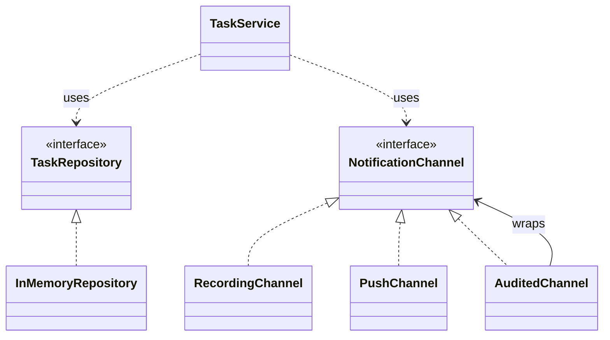

# Design, Architecture and Patterns with AI Agents

**Postgraduate software engineering · 60 minutes · Python 3.11+ · Standard library only**

Repair and extend a task-assignment service. Use requirements, UML and tests
to evaluate an AI agent's design and defend your own engineering decisions.

| Time | Activity | Evidence |
| --- | --- | --- |
| 0–5 | Setup and design brief | Identify policy and infrastructure boundaries |
| 5–17 | Lab 1 — Correct the interaction | 3 tests pass |
| 17–27 | Lab 2 — Extend with Strategy | 3 tests pass; service unchanged |
| 27–37 | Lab 3 — Verify failure boundaries | 3 tests pass |
| 37–47 | Lab 4 — Compose with Decorator | 3 tests pass; service unchanged |
| 47–57 | UML and architecture review | Sequence diagram and decision record |
| 57–60 | Final checks and submission | All 12 tests pass |

## Setup

Run from the downloaded ZIP's directory:

```sh
unzip ai_agents_lab_60min_students.zip
cd ai_agents_lab_60min
python3 --version
python3 test_lab.py all
```

Windows: use **Extract All**, open the extracted folder in a terminal, and
replace `python3` with `py -3`. No packages or API keys are needed.
Initial failures are expected: the starter contains two service defects and
unfinished push and audit adapters. One test file covers all four labs.

## Design brief

One small team owns one application release and one database. Assign a task,
save it, then notify its assignee. Offline adapters replace database and network I/O.

| Contract | Required behavior |
| --- | --- |
| R1–R2 | Save before notifying on the preferred channel. |
| R3 | Propagate `SaveError`; make zero send attempts if saving fails. |
| R4 | `NotificationError` preserves the assignment; return normally without retry. |
| R5 | Register new channels without editing `TaskService`. |
| R7 | An audit wrapper delegates once and records acceptance only after success. |

**Principles.** Single responsibility (SRP) separates policy from I/O.
Dependency inversion (DIP) makes the service depend on interfaces. Strategy
varies delivery behavior; the open/closed principle (OCP) keeps that variation
outside the service. Decorator adds behavior around an existing channel.
Observer supports independent subscribers. A modular monolith keeps modules
in one application deployable.



## Lab 1 — Correct the interaction

**Edit:** `service.py`.

Correct `assign_task` so R1–R3 hold. Preserve the injected interfaces and
exact message `You were assigned: <task title>`. Keep infrastructure outside the service.

```sh
python3 test_lab.py 1
```

**Accept when:** 3 tests pass. Inspect `get → save → send` and zero send
attempts after a failed save. Explain which responsibility belongs to each object.

## Lab 2 — Extend with Strategy

**Edit:** `push_channel.py`.

Implement `PushChannel.send`: append each accepted `(recipient, message)` to
`self.sent`. The test registers `{'push': push}`. Keep `service.py` unchanged.

```sh
python3 test_lab.py 2
```

**Accept when:** 3 tests pass and the diff shows only the push adapter changed
in this step. Explain the change Strategy absorbs and where registration belongs.

## Lab 3 — Verify failure boundaries

**Edit:** `service.py`.

Handle only `NotificationError` from delivery: log a warning without contact
details, retain the saved task and return it. Attempt once. Let unexpected
programming errors propagate. Preserve R3.

```sh
python3 test_lab.py 3
```

**Accept when:** 3 tests pass. Read one failure assertion yourself and explain
why a broad `except Exception` hides defects.

## Lab 4 — Compose with Decorator

**Edit:** `audit_channel.py`.

Implement `AuditedChannel.send`: delegate once to `self._channel`, then append
`notification.accepted` to `self.events`. On failure, propagate the exception
and record nothing. Inject the wrapper as a normal channel. Keep the service
and push adapter unchanged.

```sh
python3 test_lab.py 4
```

**Accept when:** 3 tests pass. Explain why this is Decorator rather than a new
Strategy. This in-memory acceptance record is not a durable audit log.

## UML and architecture review

Complete `sequence.mmd`: show success, `SaveError` with no send, and
`NotificationError` with a normal task return. Match participants and message
order to the code. Annotate that `save` models a completed commit.

Complete `DECISIONS.md` in at most 200 words. Compare a modular monolith with
microservices, distinguish the patterns, and address this change request:

**R6:** Notification intent must survive a process crash after commit. Assume
the worker and provider recover and the destination is valid.

Outline an atomic task-plus-outbox write and a relay. Explain the duplicate
risk if the relay crashes after provider acceptance but before recording completion.
No outbox implementation is required. Review the UML and decision record manually;
the Python tests establish neither architectural quality nor real DB durability.

## Use the agent

```text
Read README.md and test_lab.py. For Lab [1/2/3/4], explain the smallest change
and the principle it serves, then edit only the permitted file. Preserve
contracts and tests. Report actual commands/results and one remaining limitation.
```

For corrections, provide the actual failed assertion. If no agent is available,
make the same changes manually and record that route.

## Submit

```sh
python3 test_lab.py all
python3 test_lab.py all > test_results.txt 2>&1
```

Submit `service.py`, `push_channel.py`, `audit_channel.py`, `sequence.mmd`,
`DECISIONS.md`, and `test_results.txt`. Expected final result: **12 tests, OK**.
